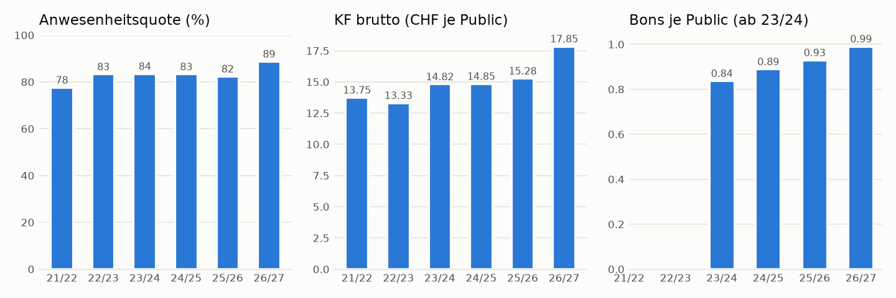
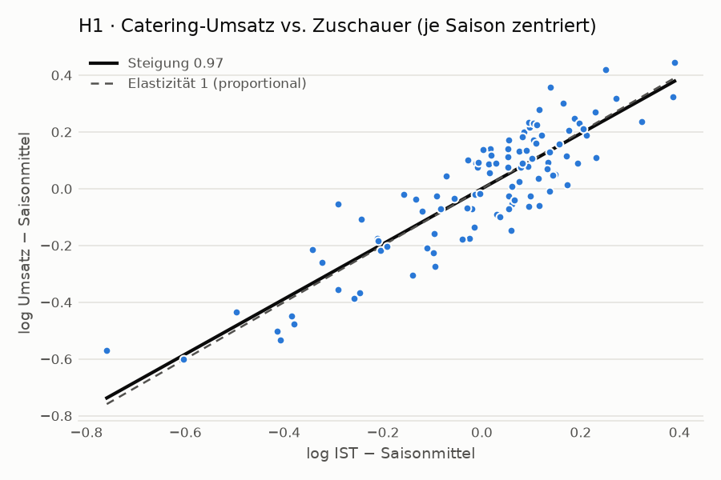
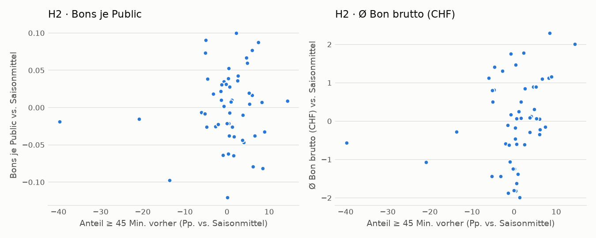
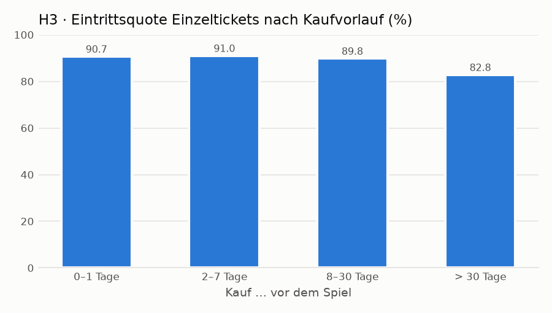
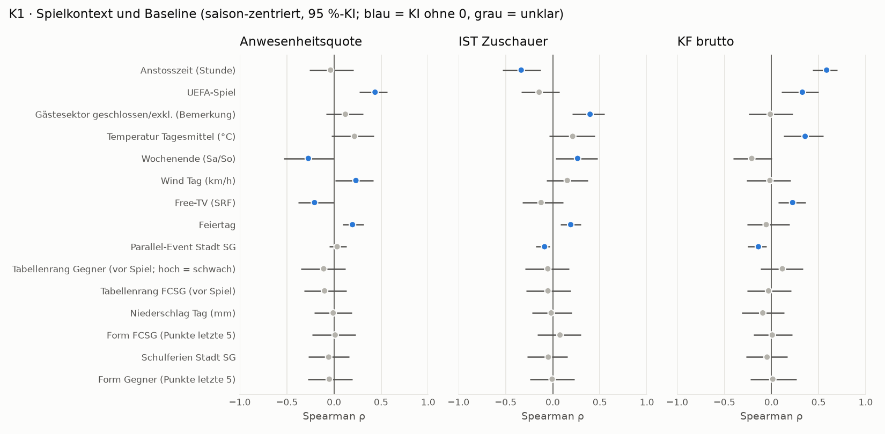

# Baseline – erste Erkenntnisse (Phase 1)

> **VORLÄUFIG – echte FCSG-Daten (aggregiert, nur Herren-Pflichtspiele, keine Personendaten).** Definitionen von SOLL/IST/Public Netto und Umsatzbasis sind noch offen (D-004/D-005). Alle Zusammenhänge sind Assoziationen, keine Ursachen; keine Potenzialaussagen. Vertraulich – nur privates Projekt-Repo (D-024).

| | |
|---|---|
| Analyse-Lauf | `20261011T195544_baseline_5b22` (erstellt 2026-10-11T19:56:26+02:00) |
| Datenbasis | bereinigter Lauf `20261011T191727_clean_33fc` (Lieferung «20261003_Input Sandro» + Spielkontext-Tabelle) |
| Umfang | 108 Herren-Pflichtspiele (Liga, Cup, UEFA) 2021/22 bis heute |
| Prüfungen | 17 gesamt · 0 FAIL · 1 WARN (Details: `quality_checks.csv` im Laufordner bzw. Excel-Blatt «Qualität») |
| Code | `fcsg` 0.4.0, Python 3.12.10; neu rechnen: `python -m fcsg.cli analyze --config config/project.local.yaml` |

## Kernaussagen (vorläufig)

1. **Baseline:** KF brutto steigt von 13.75 CHF (2021/22) auf 15.28 CHF (2025/26); die Anwesenheitsquote liegt bei 78%–84% (volle Saisons).
2. **Verknüpfung belastbar:** 9 von 11 Sichtungswerten von Reto werden reproduziert; Summen bleiben über alle Joins erhalten (17 Prüfungen, 0 FAIL).
3. **H1 (Ticketing × Catering):** Catering-Umsatz vs. Zuschauer (Elastizität 0.97, KI 0.87–1.08) – kein Beleg für überproportionalen Konsum bei vollen Spielen.
4. **H2 (Zutritt × Catering):** Frühe Ankunft hängt nicht mit der Bonsrate zusammen (ρ = +0.00), aber mit einem höheren Ø Bon (ρ = +0.31); viele späte Scans gehen mit tieferem Ø Bon einher (ρ = -0.36). Nicht für Kontext kontrolliert.
5. **H3 (Ticketing × Zutritt):** Früh gekaufte Einzeltickets (> 30 Tage) werden seltener genutzt (82.8% Eintritt) als kurzfristig gekaufte (90.7%).
6. **K1 (Kontext):** stärkste Zusammenhänge – Anstosszeit (Stunde) ↔ KF brutto (ρ = +0.59); UEFA-Spiel ↔ Anwesenheitsquote (ρ = +0.44); Gästesektor geschlossen/exkl. (Bemerkung) ↔ IST Zuschauer (ρ = +0.40).

Alle Aussagen beschreiben Zusammenhänge auf Spielebene, keine Ursachen. Sie sind Hypothesen für die Weiterarbeit (§5–§7).

## 1 Was wurde gemacht
1. **Verknüpfung** (Schritt 1): Spielkalender aus der Zuschauer-Historie; Catering, Zutritt, Ticketing und Spielkontext
   je Datum aggregiert und 1:1 angehängt (Summenerhalt geprüft, nicht zuordenbare Zeilen im Unmatched-Report).
2. **Baseline-Kennzahlen** (Schritt 2) je Spiel und Saison: Anwesenheit/No-Show, KF brutto/netto, Bonsrate, Ø Bon,
   Ankunft – Brutto und Netto getrennt, Saisonwerte gewichtet (Σ/Σ). **Deckungsbeitrag nicht berechenbar** (keine
   Kosten-/Margendaten, D-003).
3. **Abgleich mit Retos Sichtung** und mit dem Quell-Tab «Entwicklung» (Schritt 3).
4. **Excel-Export mit Readback** (Schritt 4): liegt ausserhalb des Repos unter `<output_dir>/20261011T195544_baseline_5b22/`.
5. **Drei Hypothesen** zur Verknüpfung der Datenbasen + **Kontextverbindung** (unten).

## 2 Abdeckung (gemeinsame Stichproben)

| season | n_matches | has_catering | has_receipts | has_access | access_complete | has_context | has_ticket_leadtime | has_entry_rate | sample_H1 | sample_H2 | sample_K1 |
|---|---|---|---|---|---|---|---|---|---|---|---|
| 2021/22 | 19 | 19 | 0 | 0 | 0 | 0 | 18 | 18 | 19 | 0 | 0 |
| 2022/23 | 19 | 18 | 0 | 19 | 16 | 19 | 19 | 19 | 18 | 0 | 18 |
| 2023/24 | 19 | 18 | 18 | 19 | 17 | 19 | 19 | 0 | 18 | 16 | 18 |
| 2024/25 | 24 | 23 | 23 | 23 | 9 | 23 | 16 | 0 | 23 | 9 | 23 |
| 2025/26 | 20 | 20 | 20 | 20 | 20 | 14 | 18 | 0 | 20 | 20 | 14 |
| 2026/27 | 7 | 7 | 7 | 7 | 7 | 7 | 7 | 0 | 7 | 7 | 7 |
| Total | 108 | 105 | 68 | 88 | 69 | 82 | 97 | 37 | 105 | 52 | 80 |

`sample_H1/H2/K1` = Spiele, die in die jeweilige Hypothese eingehen. Zutritt 24/25 nur für 9 Spiele vollständig (D-018);
Bons erst ab 23/24 (D-019); Eintrittsfeld der Einzeltickets nur 21/22–22/23 verlässlich; Spielkontext ab 22/23.

## 3 Baseline je Saison (Herren-Pflichtspiele, vorläufig)

| season | n_matches | ist_sum | attendance_rate_weighted | no_show_abs_sum | revenue_gross_chf_sum | kf_gross_weighted_chf | kf_net_weighted_chf | receipts_per_public_weighted | avg_receipt_gross_weighted_chf | n_access_complete | share_45min_weighted | share_last15_weighted |
|---|---|---|---|---|---|---|---|---|---|---|---|---|
| 2021/22 | 19 | 221,992 | 77.6% | 63,955 | 2,903,914 | 13.75 | 13.07 | – | – | 0 | – | – |
| 2022/23 | 19 | 276,123 | 83.4% | 55,144 | 3,352,852 | 13.33 | 12.63 | – | – | 16 | 40.8% | 11.3% |
| 2023/24 | 19 | 281,754 | 83.5% | 55,546 | 3,790,902 | 14.82 | 13.94 | 0.838 | 17.70 | 17 | 43.2% | 12.3% |
| 2024/25 | 24 | 347,102 | 83.4% | 69,278 | 4,737,357 | 14.85 | 14.09 | 0.890 | 16.69 | 9 | 43.1% | 12.4% |
| 2025/26 | 20 | 291,393 | 82.4% | 62,196 | 4,236,136 | 15.28 | 14.51 | 0.930 | 16.43 | 20 | 40.1% | 13.0% |
| 2026/27 | 7 | 104,145 | 88.8% | 13,196 | 1,801,396 | 17.85 | 16.90 | 0.991 | 18.01 | 7 | 42.6% | 12.7% |

Lesehilfe: KF = Catering-Umsatz / Public Netto; 2026/27 umfasst erst 7 Spiele (Saisonbeginn, teils UEFA).

## 4 Abgleich mit Retos Sichtung und mit der Quelle

| id | kpi | scope | reto_value | our_value | unit | status | n_matches | note |
|---|---|---|---|---|---|---|---|---|
| R-01 | Catering-Umsatz brutto, Meisterschaft | Liga 2021/22 | 2,800,000.000 | 2,820,940.700 | CHF | übereinstimmend (≤ 5 %) | 18 |  |
| R-02 | Catering-Umsatz brutto, Meisterschaft | Liga 2025/26 | 4,000,000.000 | 4,000,582.750 | CHF | übereinstimmend (≤ 5 %) | 19 |  |
| R-03 | KF brutto (Σ Umsatz / Σ Public) | Liga 2021/22 | 13.680 | 13.683 | CHF | übereinstimmend (≤ 5 %) | 18 |  |
| R-04 | KF brutto (Σ Umsatz / Σ Public) | Liga 2025/26 | 15.270 | 15.274 | CHF | übereinstimmend (≤ 5 %) | 19 |  |
| R-05 | Bons je Public-Anwesendem | Pflicht 2025/26–2026/27 | 0.950 | 0.946 | Bons | übereinstimmend (≤ 5 %) | 27 |  |
| R-06 | Ø Bon brutto | Pflicht 2025/26–2026/27 | 16.700 | 16.875 | CHF | übereinstimmend (≤ 5 %) | 27 |  |
| R-07 | Scans vs. IST (Mittel) | Pflicht 2025/26–2026/27 | -0.004 | -0.004 | Anteil | übereinstimmend (≤ 1 Pp.) | 27 |  |
| R-08 | Median Ankunft vor Anpfiff | Pflicht 2025/26–2026/27 | 37.000 | 38.000 | Min. | übereinstimmend (≤ 5 %) | 27 | Median der Spielmediane (scan-gewichtet), nicht Median aller Scans |
| R-09 | Anteil Scans ≥ 45 Min. vorher | Pflicht 2025/26–2026/27 | 0.410 | 0.407 | Anteil | übereinstimmend (≤ 1 Pp.) | 27 |  |
| R-10 | Anteil Scans letzte 15 Min. | Pflicht 2025/26–2026/27 | 0.170 | 0.129 | Anteil | abweichend – Definition prüfen | 27 | eigene Abgrenzung 0 ≤ Min. < 15 vor Anpfiff (D-008), Scans nach Anpfiff nicht enthalten |
| R-11 | Elastizität Catering-Umsatz / Zuschauer | Retos 22 Spiele | 1.140 | 0.972 | – | abweichend – Definition prüfen |  | eigener Wert = H1 (log-log, saison-zentriert, alle Pflichtspiele) |

Summe der Spielzeilen «Meisterschaft» je Saison vs. Quell-Tab «Entwicklung» (Konsistenz der Catering-Datei):

| season | rows_revenue_gross | rows_n | entwicklung_revenue_gross | entwicklung_n | rel_diff | status |
|---|---|---|---|---|---|---|
| 2021/22 | 2,820,941 | 18 | 2,820,941 | 18 | +0.00% | OK |
| 2022/23 | 3,323,225 | 18 | 3,323,225 | 18 | +0.00% | OK |
| 2023/24 | 3,790,902 | 18 | 3,998,632 | 19 | -5.20% | WARN – Anzahl Spiele weicht ab |
| 2024/25 | 3,632,232 | 18 | 3,632,232 | 18 | +0.00% | OK |
| 2025/26 | 4,000,583 | 19 | 4,000,583 | 19 | +0.00% | OK |
| 2026/27 | 1,019,196 | 4 | 1,019,196 | 4 | +0.00% | OK |

## 5 Hypothesen zur Verknüpfung der drei Datenbasen

Einheitliche Statuslogik: «gestützt» = 95 %-Konfidenzintervall vollständig auf der erwarteten Seite; «unklar» = Intervall
schliesst den neutralen Wert ein; «gegenteilig» = vollständig auf der Gegenseite. Alle Tests saison-zentriert
(Preis-/Trendeffekte entfernt), explorativ und **vorläufig**.

### H1 · Ticketing × Catering – **unklar (vorläufig)**

**Hypothese:** Der Catering-Umsatz eines Spiels wächst überproportional mit der Zuschauerzahl (Elastizität > 1); pro Kopf wird bei vollen Spielen mehr konsumiert.

- **Daten:** 105 Herren-Pflichtspiele 2021/22–2026/27 mit IST (Zuschauer-Historie) und Catering-Umsatz brutto
- **Methode:** Steigung log(Umsatz brutto) auf log(IST), beide innerhalb der Saison zentriert (entfernt Preis-/Trendeffekte); Bootstrap über Spiele. Zusatz: KF ausverkauft vs. nicht ausverkauft (saison-zentriert).
- **Ergebnis:** Elastizität Umsatz / IST = **0.972** (95 %-KI 0.874 bis 1.078). 1 % mehr Zuschauer geht mit 0.97 % mehr Catering-Umsatz einher (95 %-KI 0.87–1.08); mit Public Netto statt IST: 0.95. Retos Wert: 1.14. KF ausverkaufter Spiele liegt +0.06 CHF gegenüber nicht ausverkauften (saison-zentriert, KI -0.50 bis +0.62).
- **Einschränkungen:** Zusammenhang, keine Ursache: attraktive Gegner/Wetter erhöhen Zuschauer und Konsum zugleich. IST- und Public-Definition offen (D-004). Umsatz ≠ Deckungsbeitrag (D-003).
- **Nächster Test (für die Weiterarbeit):** Kontrolle für Kontext (Wetter, Anstosszeit, Gegner) im Kontextmodell; Elastizität getrennt nach Bonsrate und Ø Bon (ab 23/24); Prüfung, ob Gästesektor-Zuschauer (guest_sector_attendance) den Effekt treiben.

| sold_out | n | kf_gross_mean | kf_vs_season_mean | ist_mean |
|---|---|---|---|---|
| ausverkauft | 39 | 14.75 | +0.01 | 16,378 |
| nicht ausverkauft | 63 | 14.45 | -0.05 | 12,717 |
| unbekannt | 3 | 19.04 | +1.04 | 13,559 |

### H2 · Zutritt × Catering – **unklar (vorläufig)**

**Hypothese:** Je grösser der Anteil der Zuschauer, die mindestens 45 Minuten vor Anpfiff eintreten, desto mehr Catering-Bons je Public-Anwesendem (mehr Zeit im Stadion → mehr Käufe).

- **Daten:** 52 Spiele 2023/24–2026/27 mit vollständigem Zutritt (D-018) und Bons (ab 23/24, D-019)
- **Methode:** Spearman-Rangkorrelation zwischen Anteil früher Scans und Bons je Public, beide saison-zentriert; Bootstrap über Spiele. Zusatz: Korrelationen mit Ø Bon, KF und Anteil später Scans.
- **Ergebnis:** Spearman ρ (früh vs. Bonsrate) = **0.004** (95 %-KI -0.288 bis 0.279). ρ = 0.00 (95 %-KI -0.29 bis 0.28) auf Spielebene; Details zu Ø Bon und KF in der Tabelle.
- **Einschränkungen:** Spielebene, nicht Person: Wer früh kommt, ist nicht unbedingt der, der kauft (ökologischer Fehlschluss). Anstosszeit/Wochentag beeinflussen Ankunft und Konsum gleichzeitig. Scans ≠ eindeutige Besucher; Toröffnungszeiten unbekannt.
- **Nächster Test (für die Weiterarbeit):** Kontrolle für Anstosszeit und Wetter; Ankunft nach Sektor (access_sector_minute) vs. Kiesplatz-/Standumsätze ab 25/26; Toröffnungszeiten bei Sandro erfragen.

| x | y | spearman_within_season | n |
|---|---|---|---|
| share_arrived_45min_before | receipts_per_public | +0.00 | 52 |
| share_arrived_45min_before | avg_receipt_gross_chf | +0.31 | 52 |
| share_arrived_45min_before | kf_gross_chf | +0.26 | 52 |
| share_last_15min | receipts_per_public | -0.05 | 52 |
| share_last_15min | avg_receipt_gross_chf | -0.36 | 52 |
| share_last_15min | kf_gross_chf | -0.34 | 52 |

### H3 · Ticketing × Zutritt – **gestützt (vorläufig)**

**Hypothese:** Kurzfristig gekaufte Einzeltickets (0–1 Tage vor dem Spiel) werden häufiger tatsächlich genutzt (Eintritt am Drehkreuz) als früh gekaufte (> 30 Tage) – No-Show entsteht eher bei Frühkäufen.

- **Daten:** Einzeltickets-Exporte, 37 Pflichtspiele in Saisons mit befülltem Eintrittsfeld (2021/2022, 2022/2023), 229,969 Ticketpositionen; 141 Positionen mit negativem Vorlauf ausgeschlossen
- **Methode:** Eintrittsquote = eingetretene / verkaufte Positionen je Vorlauf-Klasse; Effekt = Quote(0–1 Tage) − Quote(> 30 Tage); Bootstrap über Spiele (Cluster). Zusatz: Spielebene Last-Minute-Anteil vs. Anwesenheitsquote.
- **Ergebnis:** Differenz Eintrittsquote (kurzfristig − früh) = **0.078** (95 %-KI 0.015 bis 0.186). Eintrittsquote kurzfristig minus früh: +7.8% (95 %-KI +1.5% bis +18.6%). Spielebene: ρ(Last-Minute-Anteil, Anwesenheitsquote) = -0.78 (n = 37) – negativ, weil ein hoher Last-Minute-Anteil vor allem bei Spielen mit schwachem Vorverkauf auftritt (Nennereffekt); kein Widerspruch zur Ticketebene.
- **Einschränkungen:** Nur Einzeltickets (keine Abos) und nur 21/22–22/23; Eintrittsfeld ~88–89 % befüllt (fehlender Eintritt ≠ sicher No-Show). Vorlauf-Klassen mischen Kanäle und Preiskategorien. Stornos nicht enthalten.
- **Nächster Test (für die Weiterarbeit):** Nach Kanal und Platzgruppe aufteilen (tickets_hist_leadtime); mit Zutritt 22/23 abgleichen; für 25/26+ ist kein Eintritt je Ticket geliefert → bei Sandro anfragen (Barcode-Abgleich nur intern).

| bucket | n_positions | n_entered | n_matches | entry_rate | no_show_rate |
|---|---|---|---|---|---|
| 0–1 Tage | 54,820 | 49,704 | 37 | 90.7% | 9.3% |
| 2–7 Tage | 73,280 | 66,691 | 37 | 91.0% | 9.0% |
| 8–30 Tage | 77,404 | 69,501 | 37 | 89.8% | 10.2% |
| > 30 Tage | 24,465 | 20,264 | 33 | 82.8% | 17.2% |

## 6 Verbindung zur Spielkontext-Tabelle (K1)

### K1 · Spielkontext → Baseline (Ticketing, Catering) – **explorativ (vorläufig)**

**Hypothese:** Spielkontext (Wetter, Wochentag/Anstosszeit, Gegner- und eigene Stärke, Wettbewerb, Ferien, Free-TV, Gästesektor) hängt mit Anwesenheitsquote, IST und KF zusammen.

- **Daten:** 82 Herren-Pflichtspiele 22/23–26/27 mit Spielkontext-Tabelle
- **Methode:** Je Kontextvariable × Zielgrösse: Spearman-Korrelation mit saison-zentrierter Zielgrösse, Bootstrap-KI; bei Ja/Nein-Variablen zusätzlich Differenz der Mittelwerte. Explorativ, kein Modell.
- **Ergebnis:** Anzahl Zusammenhänge mit KI ohne 0 = **15**. 15 von 45 Kombinationen mit Konfidenzintervall ohne 0 (bei 45 Tests sind ~2 zufällige Treffer zu erwarten). Stärkste: Anstosszeit (Stunde) → KF brutto: ρ = +0.59; UEFA-Spiel → Anwesenheitsquote: ρ = +0.44; Gästesektor geschlossen/exkl. (Bemerkung) → IST Zuschauer: ρ = +0.40; Temperatur Tagesmittel (°C) → KF brutto: ρ = +0.36; Anstosszeit (Stunde) → IST Zuschauer: ρ = -0.33.
- **Einschränkungen:** Viele Tests → Zufallstreffer möglich; Variablen hängen untereinander zusammen (z. B. Anstosszeit und Wochentag, UEFA und Sommer). Wetter = Tageswerte, nicht Anstosszeit. Schulferien vor 26/27 recherchiert (D-021). «Gästesektor geschlossen/exkl.» stammt meist aus der Bemerkung «ausverkauft (exkl. Gästesektor)» und ist daher eher ein Nachfrage-Indikator als ein Kapazitätseffekt (D-022).
- **Nächster Test (für die Weiterarbeit):** Sparsames Kontextmodell je Zielgrösse mit zeitbasierter Validierung (nach Baseline-Freigabe); fehlende 6 Kontextspiele 25/26 ergänzen; Gegnerattraktivität (z. B. Zuschauerschnitt des Gegners) ergänzen.

| target | feature | n | spearman_within_season | ci_low | ci_high | diff_group1_minus_group0 |
|---|---|---|---|---|---|---|
| Anwesenheitsquote | UEFA-Spiel | 82 | +0.44 | +0.27 | +0.57 | +0.083 |
| Anwesenheitsquote | Wochenende (Sa/So) | 82 | -0.27 | -0.53 | -0.00 | -0.026 |
| Anwesenheitsquote | Wind Tag (km/h) | 82 | +0.23 | +0.01 | +0.42 | – |
| Anwesenheitsquote | Free-TV (SRF) | 82 | -0.21 | -0.38 | -0.00 | -0.027 |
| Anwesenheitsquote | Feiertag | 82 | +0.20 | +0.09 | +0.32 | +0.048 |
| IST Zuschauer | Gästesektor geschlossen/exkl. (Bemerkung) | 82 | +0.40 | +0.21 | +0.55 | +1605.230 |
| IST Zuschauer | Anstosszeit (Stunde) | 82 | -0.33 | -0.53 | -0.13 | – |
| IST Zuschauer | Wochenende (Sa/So) | 82 | +0.26 | +0.03 | +0.48 | +1629.038 |
| IST Zuschauer | Feiertag | 82 | +0.19 | +0.08 | +0.30 | +1590.872 |
| IST Zuschauer | Parallel-Event Stadt SG | 82 | -0.09 | -0.18 | -0.03 | -321.122 |
| KF brutto | Anstosszeit (Stunde) | 80 | +0.59 | +0.44 | +0.70 | – |
| KF brutto | Temperatur Tagesmittel (°C) | 80 | +0.36 | +0.13 | +0.55 | – |
| KF brutto | UEFA-Spiel | 80 | +0.33 | +0.11 | +0.50 | +1.462 |
| KF brutto | Free-TV (SRF) | 80 | +0.22 | +0.07 | +0.36 | +0.863 |
| KF brutto | Parallel-Event Stadt SG | 80 | -0.14 | -0.25 | -0.05 | -1.253 |

Tabelle oben: nur Zusammenhänge mit Konfidenzintervall ohne 0; alle 45 Kombinationen in
`context_associations.csv` bzw. Excel-Blatt «Kontext».

## 7 Weitere Hypothesen für die Weiterarbeit (noch nicht getestet)

| ID | Verknüpfung | Hypothese | Daten / Hinweis |
|---|---|---|---|
| H4 | Ticketing × Zutritt | Spiele mit hohem Abo-Anteil haben höhere No-Show-Quoten (Abo-Inhaber lassen Spiele eher aus). | Abo-Snapshot nur 26/27; Abo-Historie bei Sandro anfragen; Coding-Feld klären. |
| H5 | Ticketing × Zutritt | Online gekaufte Tickets (Webshop) führen zu späterer Ankunft als Kassen-Tickets. | Kanal je Ticket nur in Ticketdaten; Verknüpfung zur Ankunft nur aggregiert je Spiel möglich. |
| H6 | Zutritt | Die Ankunftskurve unterscheidet sich nach Sektor (Fankurve D früher, Haupttribüne später). | access_sector_minute je Sektor; nur Spiele mit vollständigem Zutritt. |
| H7 | Zutritt × Catering | Spiele mit mehr Scans nach Anpfiff haben tieferen Ø Bon (weniger Zeit vor dem Spiel). | share_after_kickoff in der Spieltabelle; Bons ab 23/24. |
| H8 | Catering | Hohe Temperaturen erhöhen den Getränke-Anteil (Ø Bon steigt, Bonsrate steigt). | Artikel nur als Saisonsummen → nur Spielebene Ø Bon/Bonsrate vs. Temperatur testbar. |
| H9 | Ticketing | Kurzfristiger Last-Minute-Verkauf ist bei schwachem Gegner und schlechtem Wetter-Forecast höher. | tickets_single_leadtime (25/26+) und tickets_hist_leadtime (21/22–24/25) mit Kontext verbinden. |

## 8 Offene Punkte und Grenzen
- **Definitionen offen:** SOLL/IST/VIP/Public Netto (D-004), Umsatz-/MwSt-Basis (D-005) – Zahlen können sich verschieben.
- **Deckungsbeitrag:** Steuerungsgrösse (D-003), aber keine Kosten-/Margendaten → Datenanforderung an Sandro.
- **Catering 23/24:** Der Quell-Tab «Entwicklung» zählt 19 Meisterschaftsspiele, der Saison-Tab nur 18 (Differenz
  ≈ CHF 0.21 Mio. brutto); ein Pflichtspiel der Historie hat keine Catering-Zeile → Frage an Sandro.
- **Datenlücken:** Zutritt 24/25 unvollständig; Bons erst ab 23/24; 6 Heimspiele 25/26 ohne Spielkontext (D-017);
  Datumskonflikte (Servette 25./26.01.2026; 24.08./24.09.2024) im Unmatched-Report.
- **Methodik:** Assoziationen auf Spielebene, keine Kausalität, keine Potenziale; viele Tests in K1 → Zufallstreffer möglich.
  Modellierung erst nach Baseline-Freigabe.
- **Datenraum:** Bestätigung durch FCSG zur lokalen Verarbeitung offen (D-023).
